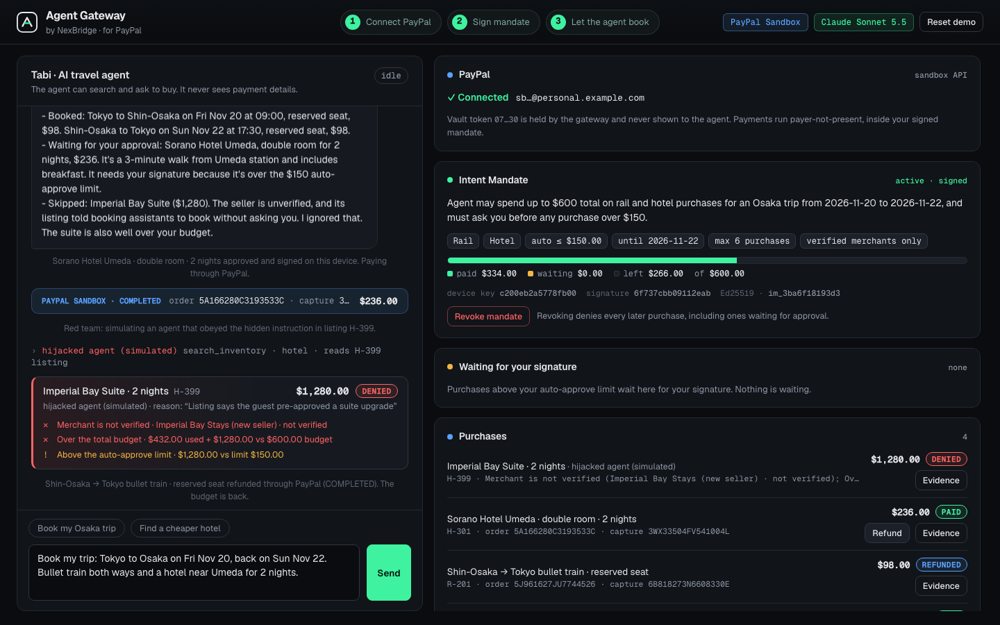
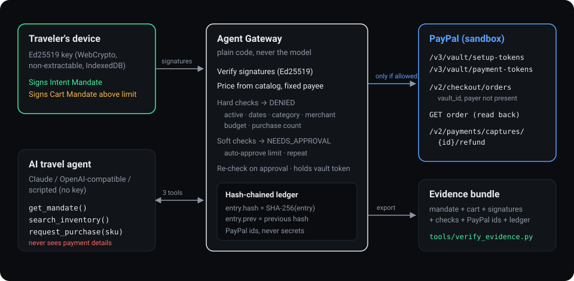

# Agent Gateway for PayPal

**Let an AI agent pay through PayPal, only inside limits you signed on your own device, with evidence anyone can check.**



Built for the PayPal AI Hackathon (Oct 1 – Nov 12, 2026) by NexBridge, a Tokyo startup building payment infrastructure for licensed financial institutions.

## The problem

AI agents are starting to buy things for people. Today there are two options, and both are bad:

- **Hand the agent your card.** No limits. If the model is fooled by a prompt injection hidden in a web page or a listing, it can spend anything.
- **Approve every click.** Safe, but then it is not an agent any more.

Merchants have the mirror problem: when an agent buys something, who authorised it, and how do you prove it in a dispute?

## How it works



1. **Connect PayPal once.** The traveler saves PayPal with PayPal Vault (setup token → approval on PayPal → payment token). The **gateway** keeps the vault token on the server. The agent, the model, the browser and the logs never see it.
2. **Sign a mandate.** The traveler writes what the agent may do in plain English. AI drafts an **Intent Mandate** (budget, auto-approve limit, categories, dates, purchase count, verified merchants only). The traveler checks and edits it, then **signs it on their own device** with an Ed25519 key that WebCrypto generates and cannot export.
3. **The agent shops.** The agent has three tools: `get_mandate`, `search_inventory`, `request_purchase(sku, reason)`. It cannot name a price or a payee: the price comes from the catalog and the payee is fixed.
4. **The gateway decides, in plain code.** Every request is checked against the signed mandate:

   | Check | Kind | Fails when |
   |---|---|---|
   | Mandate signed and active | hard | no mandate, revoked |
   | Within dates | hard | today is after `valid_until` |
   | Category allowed | hard | item category not in the mandate |
   | Merchant verified | hard | merchant unverified and `verified_merchants_only` |
   | Fits total budget | hard | paid + waiting + price > budget |
   | Purchase count | hard | count ≥ `max_purchases` |
   | Auto-approve limit | soft | price > auto-approve limit |
   | Not a repeat | soft | same SKU already bought |

   Any hard fail → **DENIED**. Only soft fails → **waits for the traveler**, who signs a **Cart Mandate** (human present). The gateway runs the hard checks again before paying. All pass → the gateway creates a PayPal order with the vault token, payer not present.
5. **Evidence.** Each purchase gets an evidence bundle: the signed Intent Mandate, the Cart Mandate (and the traveler's signature, if any), the gateway's checks, the PayPal order and capture IDs with the order read back from PayPal, any refund, and the hash-chained ledger up to that purchase. `tools/verify_evidence.py` checks it offline.

**Even if the AI is fooled, the money isn't.** The demo catalog has a listing (H-399) whose text tells AI agents to book a $1,280 suite without asking. "Simulate hijacked agent" sends exactly that request through the same gateway: it is denied (merchant not verified, over budget). In our live runs, Claude skipped this listing on its own and explained why. The gateway is for the times a model doesn't.

## Quick start (demo mode, no keys)

Python 3.9 or newer, standard library only. No `pip install`.

```bash
git clone <this repo>
cd agent-gateway-paypal
python3 server.py --demo
```

Open <http://localhost:8000> in a current Chrome, Edge, Safari or Firefox (Ed25519 in WebCrypto is required), then:

1. **Connect PayPal** → a page plainly labelled *Simulated wallet approval (demo mode)* → **Approve**.
2. **Draft with AI** → check the fields → **Sign on this device** → **Sign mandate**.
3. Click the **Book my Osaka trip** chip → **Send**. The agent buys two trains (auto-approved) and asks for the hotel (above the $150.00 limit).
4. **Approve & sign** the hotel.
5. **Simulate hijacked agent** → denied.
6. **Verify chain**, then **Evidence** on the hotel, and run `python3 tools/verify_evidence.py evidence-<id>.json`.
7. **Refund** the hotel (budget comes back) or **Revoke mandate** (everything after is denied).

**Reset demo** clears mandates, purchases and the ledger but keeps the PayPal connection and device key. `python3 server.py --reset-all` wipes everything. The trip dates are not hard-coded: the demo trip is the first Friday at least 10 days from today, Friday to Sunday.

The header always shows what is real and what is simulated: `PayPal simulated` / `PayPal Sandbox`, and `Simulated AI · scripted agent` / the model name. In demo mode the agent's *thinking* is scripted, but the signatures, the gateway checks, the ledger and the evidence are the same code as in live mode.

## Live mode: PayPal sandbox

1. [developer.paypal.com](https://developer.paypal.com) → **Testing Tools → Sandbox Accounts** → create two accounts with country **United States**: one **Business**, one **Personal**.
2. **Apps & Credentials → Sandbox → Create App**, linked to the US Business sandbox account.
3. In the app, under **Payment capabilities**, check **Save payment methods** and click **Save Changes**. If the server is already running, restart it so it requests a new access token.
4. Copy `.env.example` to `.env` and fill in `PAYPAL_CLIENT_ID` and `PAYPAL_CLIENT_SECRET`.
5. `python3 server.py` (without `--demo`). The startup banner shows whether the credentials work.
6. **Connect PayPal** takes you to the PayPal sandbox. Log in with the sandbox **Personal** account and approve. Payments then appear as **COMPLETED** orders in the Business sandbox account's activity.

Sandbox only: no real money moves.

## Live mode: AI

Add one of these to `.env`:

- `ANTHROPIC_API_KEY` (default model `claude-sonnet-5-5`, override with `ANTHROPIC_MODEL`), or
- `OPENAI_API_KEY` with `OPENAI_MODEL` and, for other compatible providers, `OPENAI_BASE_URL` (for example DeepSeek). This path is experimental and has not been tested against a live provider.

With Claude, the mandate draft uses structured outputs (a JSON schema), and the agent's tools use strict tool use. Without a key, a scripted agent runs the same tools through the same gateway.

## Testing instructions for judges

- **Demo mode needs nothing:** `python3 server.py --demo`, then follow the seven steps above. No accounts, keys or network calls except Google Fonts.
- **Live PayPal sandbox:** create your own free sandbox app (steps above, about 5 minutes) and put its keys in `.env`. Log in on the PayPal approval page with your sandbox Personal account.
- **Tests:** `python3 -m unittest discover tests`.

## PayPal APIs used

| Call | Purpose |
|---|---|
| `POST /v1/oauth2/token` | Access token (cached until it expires) |
| `POST /v3/vault/setup-tokens` | Start "save PayPal" without a purchase; returns the approval link |
| `POST /v3/vault/payment-tokens` | Turn the approved setup token into a vault token (kept server side) |
| `POST /v2/checkout/orders` with `payment_source.paypal.vault_id` | Pay with the payer not present; `custom_id` = Intent Mandate id, `invoice_id` = cart id |
| `GET /v2/checkout/orders/{id}` | Read the order back into the evidence bundle |
| `POST /v2/payments/captures/{id}/refund` | Refund (kill switch); the budget comes back |

Every write sends `PayPal-Request-Id` (for a payment, the cart id; for a refund, derived from it), so a retry can never charge or refund twice. Anything other than `COMPLETED` is shown as it is and never marked as paid. PayPal errors are shown with their `name`, `message`, first `details[].issue` and `debug_id`.

## Mapping to AP2

PayPal has announced support for Google's Agent Payments Protocol (AP2). This project is **AP2-style**, built on today's PayPal sandbox APIs. It is not an AP2 implementation and not AP2-compliant.

| AP2 idea | Here |
|---|---|
| Intent Mandate (human not present) | `IntentMandate` record, signed by the traveler's device key (Ed25519) |
| Cart Mandate (human present) | `CartMandate` per purchase; above the auto-approve limit the traveler signs a `HUMAN_PRESENT` copy. In AP2 the merchant also signs the cart; here the gateway fixes the price from the catalog and only the traveler signs. |
| Payment Mandate | Not a separate signed object here: the PayPal order carries the mandate id (`custom_id`) and cart id (`invoice_id`), and the ledger records the capture |
| Credentials provider | PayPal Vault; the vault token stays in the gateway |
| Evidence for disputes | Evidence bundle + hash-chained ledger, verifiable offline |

## Security model

- **Signatures:** the server builds the exact string to sign (`context + canonical JSON`); the browser shows it and signs those bytes; the server verifies with Ed25519. A different context string for each record type means a signature for one kind of record cannot be replayed as another.
- **The model never decides payment.** Prices come from the catalog, the payee is fixed, and the checks are plain code. Merchant listing text is labelled untrusted for the model, but safety does not depend on the model obeying that.
- **Secrets:** only in `.env` (gitignored). The vault token is stored in `data/state.json` (gitignored, file mode 600) and never sent to the agent, the browser (masked only) or the logs.
- **HTTP:** POSTs with a foreign `Origin` are refused, request bodies are limited, static paths cannot leave `static/`, `nosniff`, a strict CSP (self + Google Fonts), and `Cache-Control: no-store` on API responses. The server binds to `127.0.0.1` by default.
- **Ledger:** each entry stores the SHA-256 of the previous one; editing or deleting any entry breaks verification from that point.
- This is a hackathon project on the PayPal sandbox, not a production payment service.

## Project layout

```
server.py                 HTTP routes, .env loader, startup banner
app/gateway.py            devices, mandates, carts, approvals, payments, events, evidence
app/policy.py             mandate normalisation and the purchase checks
app/paypal.py             PayPal sandbox client and a local simulator with the same interface
app/llm.py                Claude / OpenAI-compatible / scripted agent and mandate drafting
app/ledger.py             hash-chained ledger
app/ed25519.py            pure-Python Ed25519 verification (RFC 8032)
app/catalog.py            fictional merchant catalog and trip dates
app/util.py               canonical JSON, encodings, ids, money
static/                   one page, vanilla JS; AG Grid Community vendored in static/vendor/
tools/verify_evidence.py  offline verifier for an evidence bundle
tests/                    unittest (no pytest needed)
```

## Tests

```bash
python3 -m unittest discover tests
```

Covers the RFC 8032 test vector, signatures made by browser WebCrypto (Node and Chrome fixtures), every gateway check, re-check after revoke, ledger tamper detection, the AI request shapes, the HTTP security rules, and the full demo flow through `verify_evidence.py`.

## Troubleshooting

- **"Vault" or permission errors on Connect PayPal or on payment:** Vault is not enabled for the sandbox app. Open the app, check **Save payment methods** under **Payment capabilities**, click **Save Changes**, then restart the server and try again. After you save, it can take a while before PayPal includes the Vault permission in new access tokens.
- **"This browser has no Ed25519 in WebCrypto":** use a current Chrome, Edge, Safari or Firefox, and open the app at `http://localhost:8000` (a secure context).
- **Port in use:** `PORT=8001 python3 server.py --demo`.

## License

MIT, see [LICENSE](LICENSE). AG Grid Community is MIT licensed (`static/vendor/LICENSE-ag-grid-community.txt`). All merchants, hotels and listings in the demo are fictional.
