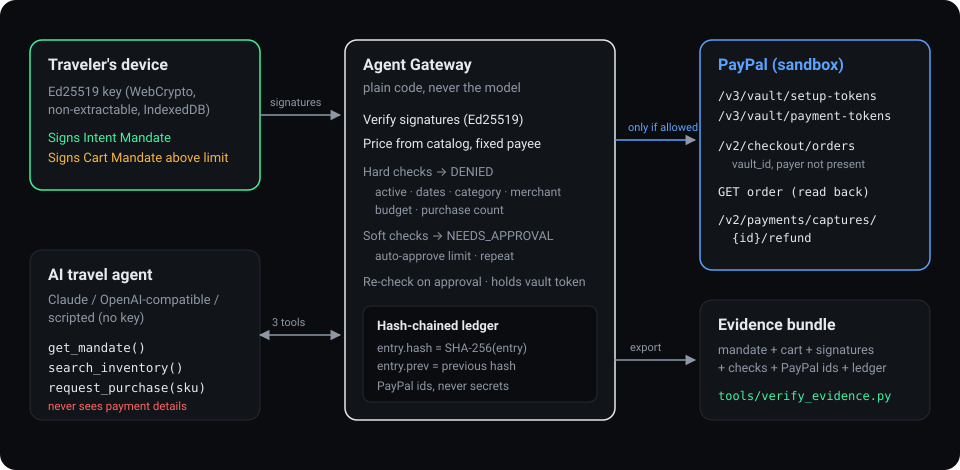
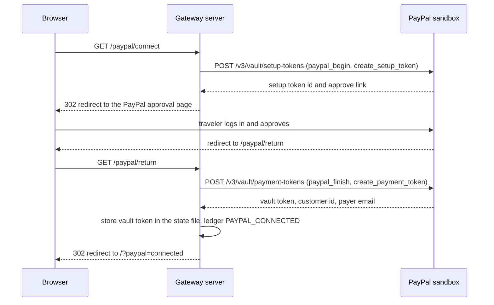
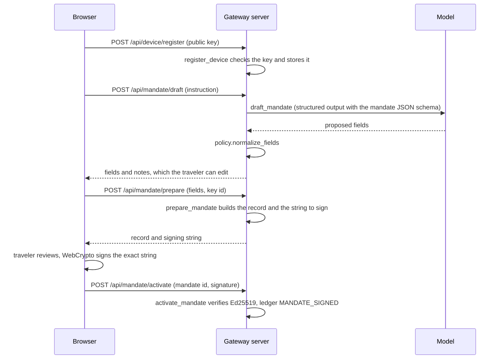
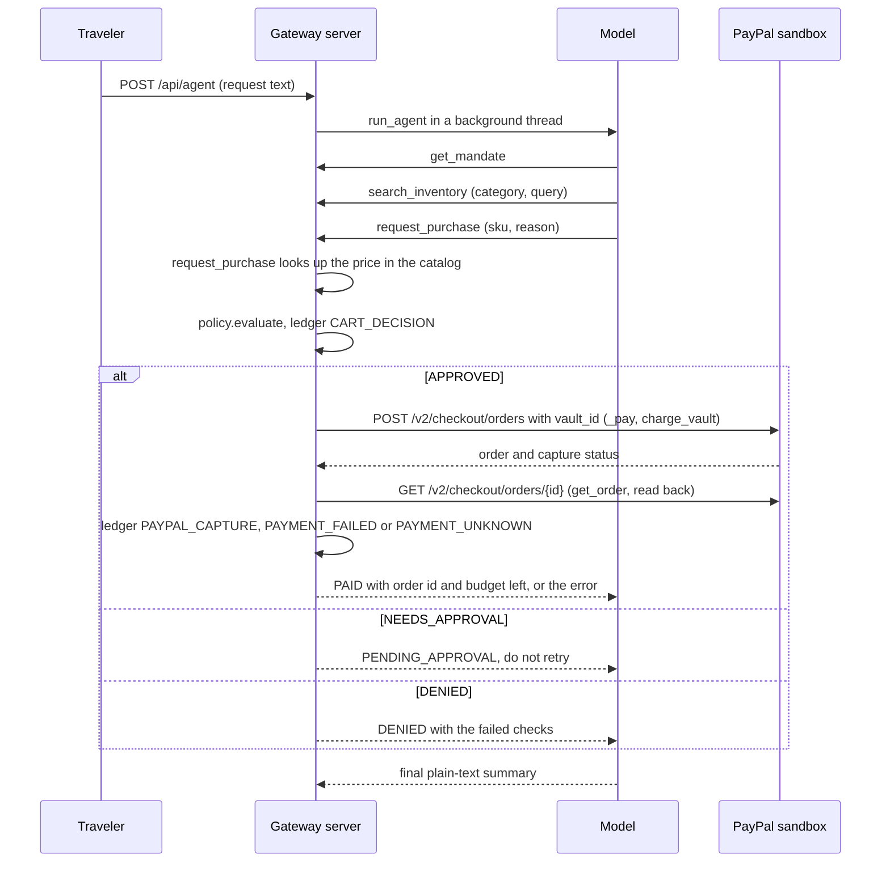
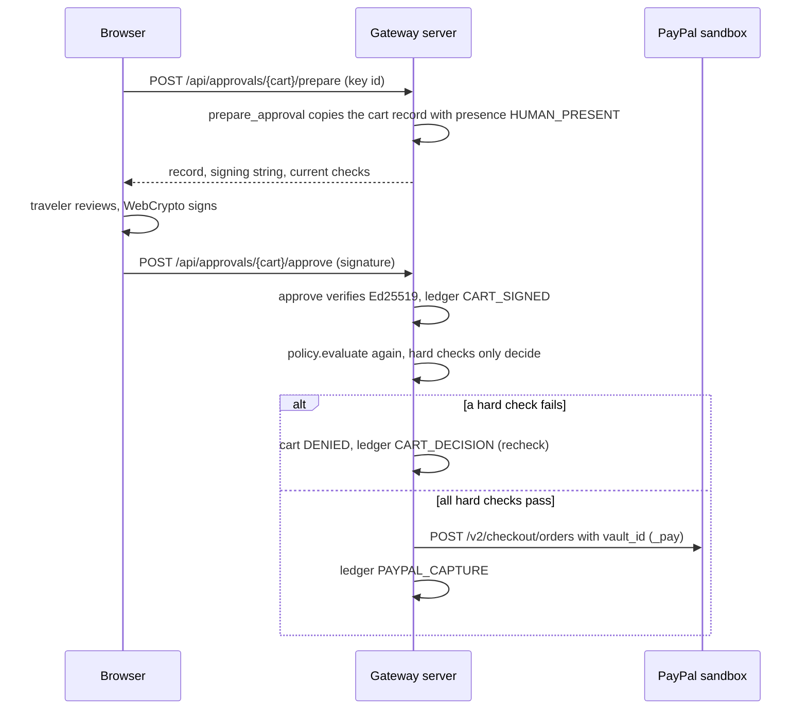

# Design

This document explains how Agent Gateway works, for people who review or change the code. Every statement here describes the code as it is in this repository. File and function names are given so you can check them.

## 1. Problem and goals

An AI agent that buys things for a person needs a way to pay. Giving it a card has no limits, and asking the person to approve every step removes the point of an agent. Agent Gateway lets the person sign, once, what the agent may buy. Code outside the model then checks every purchase against that signed record before any money moves through PayPal. The design goals are:

- The model never decides whether money moves. Plain code does, using the signed mandate, the catalog price and the purchases so far.
- The agent never sees payment details. The PayPal vault token stays on the server.
- The person's consent is a signature made on their own device, not a checkbox on the server.
- Every payment leaves an evidence bundle and a hash-chained ledger that a third party can check without the server: the signatures, that the cart and the capture are the ones the ledger recorded, and the chain. Sections 6 and 8 say what such a check cannot show.

## 2. Structure and trust boundaries

There are four parts:

| Part | Code | Trusted for |
|---|---|---|
| Browser (the traveler's device) | `static/app.js` | Holding the signing key and signing what the traveler approves |
| Gateway server | `server.py`, `app/gateway.py`, `app/policy.py` | Checks, state, PayPal calls, ledger |
| Model | `app/llm.py` (Claude, an OpenAI-compatible API, or a scripted agent) | Nothing. Its output is treated as a request, never as a decision |
| PayPal sandbox | `app/paypal.py` | Moving money and reporting order and capture status |

**What can reach the model:**

- The system prompt (`AGENT_SYSTEM` in `app/llm.py`) and the traveler's chat messages.
- Up to 8 earlier user/agent turns, as plain text (`MAX_HISTORY` in `app/gateway.py`).
- Tool results:
  - `get_mandate`: summary, constraints, trip, budget left, purchases and pending approvals.
  - `search_inventory`: catalog items, including the merchant-written `listing_text_untrusted`.
  - `request_purchase`: the result status, the reason, the amount, the PayPal **order id**, the budget left, or an error message. A PayPal error message can include PayPal's `debug_id`. When the payment result is unknown, the result also carries a note not to retry the item.
- For drafting a mandate: the traveler's instruction, today's date and the demo trip dates.

**What never reaches the model:**

- The PayPal vault token, the PayPal customer id and the payer's email address.
- PayPal access tokens, and the client id and secret from `.env`.
- Capture ids and refund ids.
- Device public keys and signatures.

**What never leaves the server:** the vault token (the page shows only its last two characters, such as `…yz`), the key of the vault token's ledger fingerprint, PayPal access tokens, and the secrets in `.env`.

The other items above do reach the browser. `/api/status` shows the payer's email and the vault token only in masked form (`mask_email` and `mask_tail` in `app/util.py`). The evidence bundle also masks the payer's email, both in its `paypal` part and in the order read back from PayPal. The bundle contains public keys, signatures and capture ids. The PayPal customer id is written into the ledger's `PAYPAL_CONNECTED` entry, so it reaches the browser (`/api/ledger`) and every evidence bundle.

## 3. Main flow

### 3.1 Connect PayPal (Vault, no purchase)

The ledger entry stores a keyed fingerprint of the vault token (HMAC-SHA256), not the token. The key is random, is made on first use and stays in the state file, so the fingerprint cannot be used to test guesses of the token. In demo mode `PayPalSimulated` returns a link to `/paypal/sim-approve`, a page labelled "Simulated wallet approval (demo mode)".

### 3.2 Draft and sign the Intent Mandate

With Claude, drafting uses structured outputs (`output_config.format` with a JSON schema). With an OpenAI-compatible API it uses a named function call. Without a key, `ScriptedAI.draft_mandate` reads amounts, categories and dates with plain rules. In every case `normalize_fields` cleans the result: it removes unknown categories, lowers the auto-approve limit to the budget if needed, caps the budget at 1,000,000, keeps `max_purchases` between 1 and 20 (default 6), moves a past end date forward and limits mandates to 90 days.

### 3.3 Agent search and purchase request

The agent can only name a SKU and a reason. The price comes from `app/catalog.py`, and the payee is fixed (`MERCHANT_NAME`). The loop stops after 10 model rounds (`MAX_ROUNDS` in `app/llm.py`). Each step is pushed as an event that the browser polls (`/api/events`).

### 3.4 Human approval (Cart Mandate signed by the traveler)

`prepare_approval` refuses a key that is not the one that signed the mandate. `POST /api/approvals/{cart}/decline` sets the cart to `DECLINED` (ledger `CART_DECLINED`) and releases the reserved budget.

### 3.5 Hijack demo, refund, revoke

- **Hijack demo** (`POST /api/redteam/hijack`, `Gateway.hijack`): calls `request_purchase("H-399", ...)` with the actor `hijacked agent (simulated)`. No model is involved. It shows what happens when a model has obeyed the instruction in the H-399 listing: the same checks run. Under the demo mandate the request is denied. Under a mandate that allows the item, it would be paid or wait for approval like any other request.
- **Refund** (`POST /api/purchases/{cart}/refund`, `Gateway.refund`): only a `PAID` cart with a capture id. Calls `POST /v2/payments/captures/{id}/refund` for the full amount. If PayPal answers `COMPLETED` or `PENDING`, the cart becomes `REFUNDED` and its budget is released. Ledger `PAYPAL_REFUND`.
- **Revoke** (`POST /api/mandate/revoke`, `Gateway.revoke_mandate`): sets the mandate to `revoked` (ledger `MANDATE_REVOKED`). Later requests fail the `mandate_active` check. Carts that are waiting stay `PENDING_APPROVAL`, but approving one is denied at the re-check. Signing a new mandate marks the old one `replaced`.

## 4. Data structures

### 4.1 Signing: canonical JSON and context strings

What is signed is a string: a context line followed by canonical JSON of the record (`app/util.py`).

| Item | Value |
|---|---|
| Canonical JSON | `json.dumps(obj, sort_keys=True, separators=(",", ":"), ensure_ascii=False)`, UTF-8 |
| Intent Mandate context | `"NexBridge Agent Gateway \| Intent Mandate v1\n"` |
| Cart Mandate context | `"NexBridge Agent Gateway \| Cart Mandate v1\n"` |
| Algorithm | Ed25519. The browser signs with WebCrypto, and the server verifies with `app/ed25519.py` |
| Device key | Generated in the browser as non-extractable and stored in IndexedDB (`agent-gateway` / `keys` / `device`) |
| Key id | First 16 hex characters of SHA-256 of the raw 32-byte public key |

The server builds the string and returns it. The browser signs those exact bytes. The two context strings mean a signature over one kind of record cannot be used as a signature over the other kind.

### 4.2 Intent Mandate (`prepare_mandate`)

| Field | Meaning |
|---|---|
| `type`, `version` | `"IntentMandate"`, `1` |
| `id` | `im_` + 12 hex characters |
| `issued_at` | UTC time, ISO 8601 |
| `principal.device_key_id` | Key id of the signing device |
| `agent` | `{"id": "tabi-travel-agent", "name": ...}` |
| `merchant` | Payee name and PayPal environment (`sandbox` or `simulated`) |
| `presence` | `"HUMAN_NOT_PRESENT"` |
| `instruction` | The traveler's own words, up to 1,000 characters |
| `constraints.currency` | `"USD"` |
| `constraints.total_budget` | Decimal string, for example `"600.00"` |
| `constraints.auto_approve_limit` | Decimal string, at most the budget |
| `constraints.allowed_categories` | Subset of `rail, hotel, flight, activity, dining, transfer, shopping` |
| `constraints.max_purchases` | Integer, 1 to 20 |
| `constraints.valid_until` | `YYYY-MM-DD`, inclusive |
| `constraints.verified_merchants_only` | Boolean |
| `trip` | Optional `origin`, `destination`, `start_date`, `end_date`, `travelers` |
| `summary` | One sentence for the traveler to check, up to 240 characters |

The drafting notes are shown to the traveler but are not part of the signed record.

### 4.3 Cart Mandate (`_cart_record`)

One per purchase request, created by the gateway, not by the agent.

| Field | Meaning |
|---|---|
| `type`, `version`, `id` | `"CartMandate"`, `1`, `cart_` + 12 hex characters |
| `intent_mandate_id` | Id of the mandate it is checked against |
| `intent_mandate_hash` | SHA-256 of that mandate's signed string |
| `created_at` | UTC time |
| `presence` | `"HUMAN_NOT_PRESENT"`. The copy the traveler signs has `"HUMAN_PRESENT"` |
| `agent`, `requested_by` | The agent, and who asked (`Tabi agent` or `hijacked agent (simulated)`) |
| `payee` | Fixed payee name and PayPal environment |
| `merchant` | Catalog merchant name and whether it is verified |
| `items` | One item: `sku`, `title`, `category`, `detail`, `quantity` 1, `unit_price` |
| `total` | `currency` and `value` |
| `reason` | The agent's reason, up to 300 characters |
| `approved_at`, `approver_key_id` | Only on the human-present copy |

Auto-approved carts are not signed by anyone. Their authority is the Intent Mandate, and the evidence shows they were within the auto-approve limit.

### 4.4 Ledger entry (`app/ledger.py`)

| Field | Meaning |
|---|---|
| `seq` | 1, 2, 3, ... with no gaps |
| `ts` | UTC time |
| `kind` | `PAYPAL_CONNECTED`, `MANDATE_SIGNED`, `MANDATE_REVOKED`, `CART_DECISION`, `CART_SIGNED`, `CART_DECLINED`, `PAYPAL_CAPTURE`, `PAYPAL_REFUND`, `PAYMENT_FAILED`, `PAYMENT_UNKNOWN` |
| `summary` | One line for people |
| `data` | Ids, amounts, results and fingerprints. Never the vault token or keys |
| `prev` | `hash` of the previous entry; the first entry uses 64 zeros |
| `hash` | SHA-256 of the canonical JSON of the entry without `hash` |

`verify_entries` recomputes the chain and reports the first entry that is out of sequence, points to the wrong previous hash, or was changed.

### 4.5 Evidence bundle (`Gateway.evidence`, `GET /api/evidence/{cart}`)

| Field | Content |
|---|---|
| `format` | `"nexbridge-agent-gateway-evidence/v1"` |
| `generated_at`, `cart_id`, `status` | When it was made, which cart, its status |
| `intent_mandate` | Record, signed string, signature, public key, key id, `alg`, status, `revoked_at` |
| `cart_mandate` | Record and the string it would be signed as (human not present) |
| `cart_approval` | The human-present record, signed string, signature, public key, key id, `alg`, or `null` |
| `gateway_decision` | Result, reason, every check, time |
| `gateway_recheck` | The re-check at approval, or `null` |
| `paypal` | Order id and status, capture id and status, the payer's email (masked), environment, and the order as read back from PayPal (payer's email masked). When the read-back succeeded, the statuses and the capture id are the ones it reported; if the first answer differed, it is kept as `first_answer` |
| `refund` | Refund id and status, or `null` |
| `ledger` | All entries up to the last one about this cart, and that entry's hash |

`tools/verify_evidence.py` checks a bundle without the server:

- the mandate's signed string matches its record and its signature verifies;
- the key id is the SHA-256 prefix of the public key and is the principal;
- the cart's string matches its record and points to the mandate by id and hash;
- if there is an approval: its string matches, its signature verifies, it was made by the mandate's key, and it is the same cart marked `HUMAN_PRESENT`;
- the category is allowed, the cart total is within the total budget, and it is under the auto-approve limit or approved;
- the ledger chain is intact, its head matches, and it records the signed mandate and the decision for exactly this cart (same cart hash and amount);
- if the cart was paid: the ledger records the capture with the same order id, capture id and amount, the order read back is the same order, and PayPal reported the order and capture as `COMPLETED`;
- if there is an approval: the ledger records the approval signature.

The verifier treats a bundle as input from someone else. Text from the bundle is printed with control characters shown as escapes (`show`), so a title cannot redraw the terminal or forge a result line. A file that is not built like a bundle gives `NOT VERIFIED` with the reason, not a traceback. The exit code is 0 only when every check passes.

## 5. Checks

`policy.evaluate` runs every check, always in this order, and returns all of them so the UI can show each result.

| # | Key | Kind | Fails when |
|---|---|---|---|
| 1 | `mandate_active` | hard | No mandate, or its status is not `active` (revoked or replaced), or it was signed for another PayPal environment than the one the server runs in (`Gateway._mandate_status`) |
| 2 | `time_window` | hard | Today's UTC date is after `valid_until` |
| 3 | `category` | hard | The item's category is not in `allowed_categories` |
| 4 | `merchant` | hard | The merchant is not verified and `verified_merchants_only` is true |
| 5 | `budget` | hard | The amount already used plus this price is more than the total budget |
| 6 | `count` | hard | The number of purchases already used is `max_purchases` or more |
| 7 | `auto_limit` | soft | The price is above `auto_approve_limit` |
| 8 | `repeat` | soft | The same SKU is already among the purchases used |

"Used" means carts under this mandate with status `PAID`, `PAYING`, `CAPTURE_PENDING`, `PAYMENT_UNKNOWN` or `PENDING_APPROVAL` (`Gateway._usage`). Refunded, declined, denied and failed (`NOT_EXECUTED`) carts do not count. `PAYMENT_UNKNOWN` counts because PayPal may have charged: its answer was lost or unclear.

Any hard failure gives `DENIED`. Only soft failures give `NEEDS_APPROVAL`, and the cart's price is reserved in the budget while it waits. No failures gives `APPROVED`, and the gateway pays at once.

**Why the hard checks run again on approval.** Time passes between the request and the traveler's signature. In that time the traveler may revoke the mandate or sign a new one, the end date may pass, and other purchases may use the budget or the purchase count. The traveler's signature approves this cart. It does not lift the mandate's limits. So `approve` runs `evaluate` again, leaving this cart out of the usage totals, and pays only if every hard check still passes. The soft checks are what the signature approves, so they do not block at this point.

## 6. Security model

**What the design defends against:**

| Threat | Defence |
|---|---|
| Prompt injection in merchant text | Prices, payee and limits are enforced by code the model cannot change. Listing text is labelled untrusted for the model, but safety does not depend on the model obeying that label |
| Model acting beyond its authority | The agent has three tools. It cannot set a price or a payee, and it cannot approve, refund or revoke |
| Spending over the limits | Hard checks against the signed mandate. Waiting carts reserve budget. Hard checks run again on approval |
| Replaying a signature | Signatures cover a context line plus the full record, including a fresh id and time. A mandate signature is accepted only for the one prepared mandate, and an approval only for a cart that is waiting and has a prepared approval |
| Charging twice | A payment is sent once, with `PayPal-Request-Id` set to the cart id. When its answer is lost or unclear, the cart becomes `PAYMENT_UNKNOWN` and keeps its amount in the budget, and the same item again is a repeat that needs the traveler's signature. A refund sends `rf_` plus the cart id, so trying it again cannot refund twice |
| Changing history | The hash-chained ledger shows an edited entry, and a deleted entry that has entries after it. The offline verifier also checks that the cart and the capture in a bundle are the ones the ledger recorded. The limits are listed below |
| Requests from other sites to the local server | The server answers only for its own names (`allowed_hosts` in `server.py`): `localhost`, `127.0.0.1` and `[::1]` with its port, and the host of `BASE_URL`. Any other `Host` gets 421, which covers a page that points its own domain at this machine (DNS rebinding). POSTs with a foreign `Origin` are refused |
| Requests that are too large or cannot be stored | Request bodies are limited to 64 KB, and a negative length is refused. Text that is not valid Unicode is refused, and model output is cleaned before it is stored (`clean_text`). A connection that stays silent for 15 seconds is dropped |

The HTTP server also sends `X-Content-Type-Options: nosniff`, a Content Security Policy that allows scripts only from the server itself (styles and fonts also from Google Fonts), and `Cache-Control: no-store` on API responses. Static files cannot be read from outside `static/`.

**What it does not defend against:**

- **A compromised server.** The server holds the vault token and builds the strings the traveler signs. The signing dialog shows a summary built from the record the server returns, and the exact string behind a toggle. A compromised server could also pay without any signature.
- **A compromised traveler device or browser.** Whoever controls the browser can sign with the device key.
- **A compromised PayPal account or PayPal app credentials.**
- **Wrong purchases inside the limits.** A model fooled by merchant text can still buy the wrong thing inside the signed limits, for example a second seat on the same train. The checks cap what it can spend, not what it picks.
- **The holder of the ledger.** The head of the hash chain is not anchored anywhere outside the server. Whoever can write the state file can cut entries off the end or rebuild every hash, and **Reset demo** clears the ledger. An evidence bundle shows that it agrees with itself. It cannot show that the public key in it belongs to the traveler, or what PayPal really did.
- **Anyone who can reach the server.** There is no login (see section 8).

**Where secrets live:**

| Secret | Where |
|---|---|
| Device signing key | The traveler's browser (IndexedDB), non-extractable. The server stores only the public key |
| PayPal vault token | The state file on the server: `data/state.json` for the sandbox, `data/state-simulated.json` for the demo (gitignored; set to file mode 600 after every save). The UI shows only its last two characters. The ledger stores a keyed fingerprint (HMAC-SHA256). Never in events, evidence or logs |
| Key of the vault token fingerprint | The state file only (under `secrets`). Never sent anywhere |
| PayPal client id and secret, AI API keys | `.env` on the server (gitignored) |
| PayPal access token | Server memory only |

## 7. Relation to AP2

This project follows the shape of the Agent Payments Protocol (AP2): an Intent Mandate signed by the person while they are not present, and a Cart Mandate for a specific purchase. It is not an implementation of AP2 and does not claim compatibility.

| AP2 idea | Here | Difference |
|---|---|---|
| Intent Mandate | `IntentMandate` signed by the device key | Own JSON format and context string |
| Cart Mandate | `CartMandate` per purchase. Above the limit the traveler signs a `HUMAN_PRESENT` copy | In AP2 the merchant also signs the cart. Here the gateway sets the price from its catalog and only the traveler signs |
| Payment Mandate | No separate signed object | The PayPal order carries the mandate id (`custom_id`) and the cart id (`invoice_id`), and the ledger records the capture |
| Payment credentials | PayPal Vault token held by the gateway | The gateway is both the checker and the holder of the token |
| Evidence for disputes | Evidence bundle and hash-chained ledger | Not tied to any PayPal dispute process |

## 8. Known limitations

- **Sandbox only.** `server.py` creates only the sandbox PayPal client. All amounts are in USD.
- **Demo catalog.** Ten fictional items are hard-coded in `app/catalog.py`. There is no real merchant behind them, and prices do not change.
- **One traveler, one mandate.** There is one active mandate at a time. Approvals must be signed with the key of the device that signed the mandate. If the browser's site data is cleared, the key is lost and a new mandate is needed.
- **State in a JSON file, one per PayPal mode.** The sandbox uses `data/state.json` and the demo uses `data/state-simulated.json` (`state_path` in `server.py`), so a mandate signed in one mode is not there in the other. The signed mandate also names its PayPal environment, and the `mandate_active` check fails when that is not the environment the server runs in. The file is rewritten after every change. Locking is in-process (`threading.RLock`), so only one server process should use a file.
- **No login.** The server has no user accounts. Anyone who can reach it can use it: any client can register its own device key and sign a new mandate, which replaces the current one. It binds to `127.0.0.1` by default; setting `HOST` changes that. Under any address other than localhost it answers only when `BASE_URL` names that address. Do not host it with real keys; a hosted demo must run with `--demo`.
- **No webhooks or later status checks.** The status is what the Orders call returns, plus one read-back right after. A capture that stays `PENDING` is not checked again, and later reversals or disputes are not seen.
- **An unknown payment result is not resolved.** When PayPal's answer is lost or unclear, the cart becomes `PAYMENT_UNKNOWN` and keeps its amount in the budget. The gateway does not ask PayPal again later, and such a cart cannot be refunded or released in the UI; only **Reset demo** clears it. The traveler has to check the PayPal account.
- **Refunds are full refunds** of `PAID` carts only.
- **Evidence for current mandate only.** Evidence is available only for carts under the mandate the server holds now. After a new mandate the endpoint returns 410. After a reset the purchase no longer exists, and it returns 404.
- **The verifier checks one cart.** It does not add up budget or count across all carts in the ledger, and it imports modules from this repository. Of the eight checks it repeats three: the category, the total budget for this one cart, and the auto-approve limit or an approval. It does not check the dates, merchant verification, the purchase count or the time of a revocation.
- **The ledger head is not anchored.** Entries removed from the end of the ledger, or a ledger whose hashes were all rebuilt, still verify.
- **Dates use UTC.** `valid_until` is compared with today's UTC date, and there is no start date check.
- **Ed25519 code is not constant-time.** `app/ed25519.py` is used to verify signatures (and to sign in tests), not to keep secrets.
- **The OpenAI-compatible path** has not been tested against a live provider.
- **The hijack demo is simulated.** It calls `request_purchase` directly. It does not make a model follow the injected text. Its result depends on the mandate that is signed.

## 9. Code map

| File | What it does |
|---|---|
| `server.py` | HTTP routes, host and origin checks, `.env` loader, security headers, startup banner, simulated approval page |
| `app/gateway.py` | Devices, PayPal connection, mandates, carts, approvals, payments, refunds, agent runs, events, evidence |
| `app/policy.py` | `normalize_fields` (cleans a mandate draft) and `evaluate` (the checks) |
| `app/paypal.py` | `PayPalSandbox` (REST client) and `PayPalSimulated` (same interface, no network) |
| `app/llm.py` | Tool definitions, system prompts, `AnthropicAI`, `OpenAICompatAI`, `ScriptedAI`, `from_env` |
| `app/ledger.py` | Hash-chained ledger and `verify_entries` |
| `app/ed25519.py` | Ed25519 (RFC 8032) in pure Python |
| `app/catalog.py` | Demo items, trip dates, search and the agent's view of an item |
| `app/util.py` | Canonical JSON, base64url, ids, time, money, masking, context strings |
| `static/index.html`, `static/app.js`, `static/styles.css` | The single page: device key, chat, cards, ledger grid, signing dialog |
| `static/vendor/` | AG Grid Community (MIT), used for the ledger table |
| `tools/verify_evidence.py` | Offline evidence verifier |
| `tests/` | Unit tests. `tests/fixtures/chrome_evidence.json` is a bundle signed by Chrome's WebCrypto |

**How PayPal errors are handled:**

- Every PayPal request goes through `PayPalSandbox._open`.
  - An HTTP error becomes a `PayPalError` with PayPal's `name`, `message`, the first item of `details` and the `debug_id`.
  - If PayPal cannot be reached, the error is `NETWORK_ERROR`.
  - If PayPal does not answer in time (40 seconds by default), the error is `TIMEOUT`.
  - `PayPalError.sent` is false when the request never reached PayPal: an error while connecting, or any error while getting the access token.
- **Payment refused or not sent:** if PayPal answers with a 4xx error, or the request never left, the cart is marked `NOT_EXECUTED` and its budget is free again. The ledger records `PAYMENT_FAILED` with the `debug_id`. A permission error gets a hint about enabling Vault (`VAULT_HINT`).
- **Payment result unknown:** after a timeout, a 5xx answer, a dropped connection or an answer that cannot be read, PayPal may have charged. The cart becomes `PAYMENT_UNKNOWN` and keeps its amount in the budget, and the ledger records `PAYMENT_UNKNOWN`. The message says so: "PayPal did not answer in time. The payment may still have gone through, so its amount stays counted in the budget. Check the PayPal sandbox account." (`PAYMENT_TIMEOUT_TEXT`). The result that goes back to the agent says "Do not retry this item".
- **Which answer counts:** with an order id, the gateway reads the order back and uses the statuses and the capture id from that read-back. If the read-back fails, it uses the first answer. `payment_status` in `app/gateway.py` then decides:
  - order and capture `COMPLETED`: `PAID`;
  - capture `PENDING`: `CAPTURE_PENDING`, and its amount still counts as used;
  - capture `DECLINED` or `FAILED`, or an order that was not captured: `NOT_EXECUTED`;
  - anything else, for example an order PayPal calls `COMPLETED` with no capture: `PAYMENT_UNKNOWN`.
  - A status other than `COMPLETED` is never marked as paid.
- **Refund error or timeout:** the request returns 502 with PayPal's error, and the cart's status does not change.
- **Error from PayPal on Connect PayPal** (including a timeout): the message is stored with the connection, the page goes back to `/?paypal=error`, and the PayPal card shows the message.
- **Access token:** the first request after start sends `ignoreCache=true`, so PayPal does not return an older cached token (for example one issued before Vault was enabled). After that, a new token is requested when the current one is within 60 seconds of expiring.

**Common changes:**

- **Add a check.**
  - Add an `add(...)` call in `policy.evaluate`, marked `HARD` or `SOFT`, and its failure text in `_fail_text`. The UI and the agent show checks from the decision, so they need no change.
  - If the check needs a new mandate field, add it in four places: `normalize_fields`, the `constraints` in `Gateway.prepare_mandate`, `MANDATE_TOOL` in `app/llm.py`, and the draft form in `static/app.js` (`renderDraftFields`).
  - Add a test in `tests/test_policy.py`.
- **Add a catalog item.** Add an entry to `_ITEMS` in `app/catalog.py`. Use a category from `CATEGORIES`, and set `when` to `start`, `end`, `mid` or `stay`. Use fictional names only.
- **Change the model.** Set `ANTHROPIC_MODEL` in `.env`. Provider code is in `app/llm.py`, and `from_env` picks the provider.
- **Add a PayPal call.**
  - Add the method to both `PayPalSandbox` and `PayPalSimulated` with the same signature.
  - Call it from `Gateway`, record the result in the ledger, and add a test.
  - Do not add a tool that lets the agent move money: every payment must go through `request_purchase` and the checks.

## 10. Running and verifying

- **Demo mode (no keys):** `python3 server.py --demo`, then open http://localhost:8000. PayPal is simulated and the agent is scripted. Signatures, checks, the ledger and evidence use the same code as live mode.
- **Live mode:** copy `.env.example` to `.env`. Fill in the client id and secret of your own PayPal sandbox app with Save payment methods enabled (see the README), and optionally `ANTHROPIC_API_KEY`. Then run `python3 server.py`. The startup banner shows whether the PayPal credentials work and which AI is used.
- **Tests:** `python3 -m unittest discover tests`. They need no network and no keys.
- **Evidence:** in the UI, click **Evidence** on a purchase, then run `python3 tools/verify_evidence.py evidence-<cart id>.json`. The exit code is 0 only when every check passes.
- **Reset:** **Reset demo** in the UI clears mandates, purchases, events and the ledger, and keeps the PayPal connection and device keys. `--reset-all` deletes the state file of the mode it is run in: `python3 server.py --reset-all` deletes `data/state.json` (sandbox), and `python3 server.py --demo --reset-all` deletes `data/state-simulated.json` (demo).
